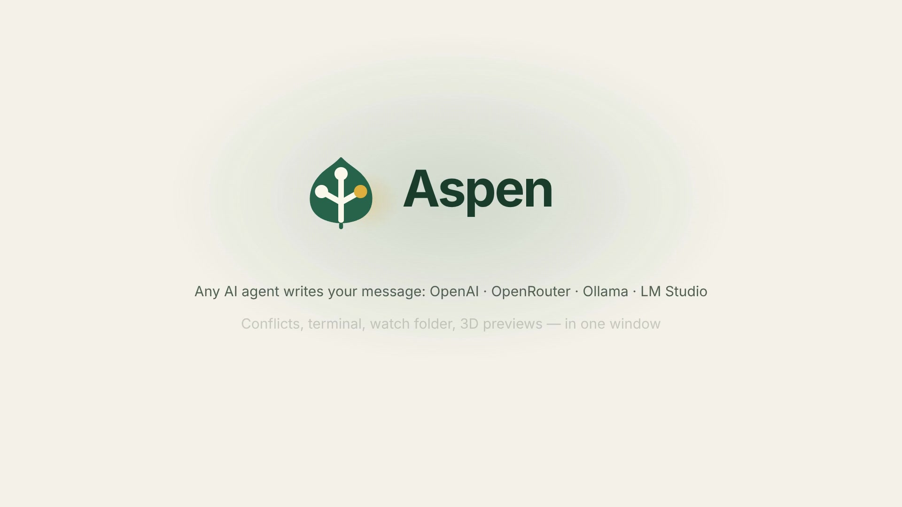
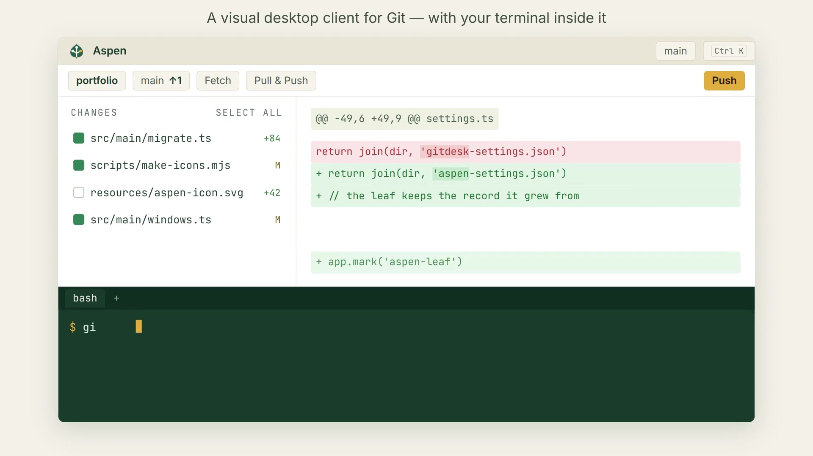
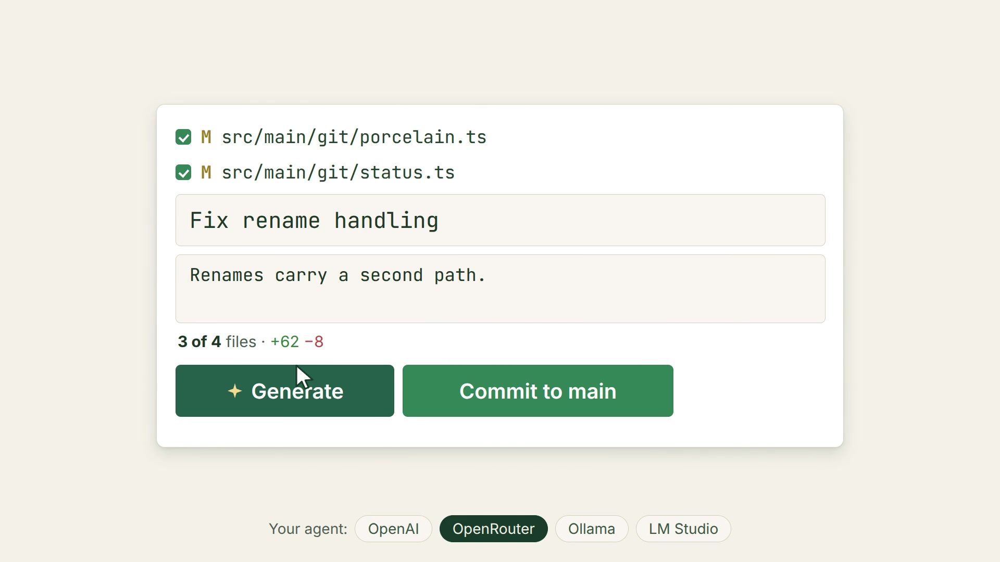
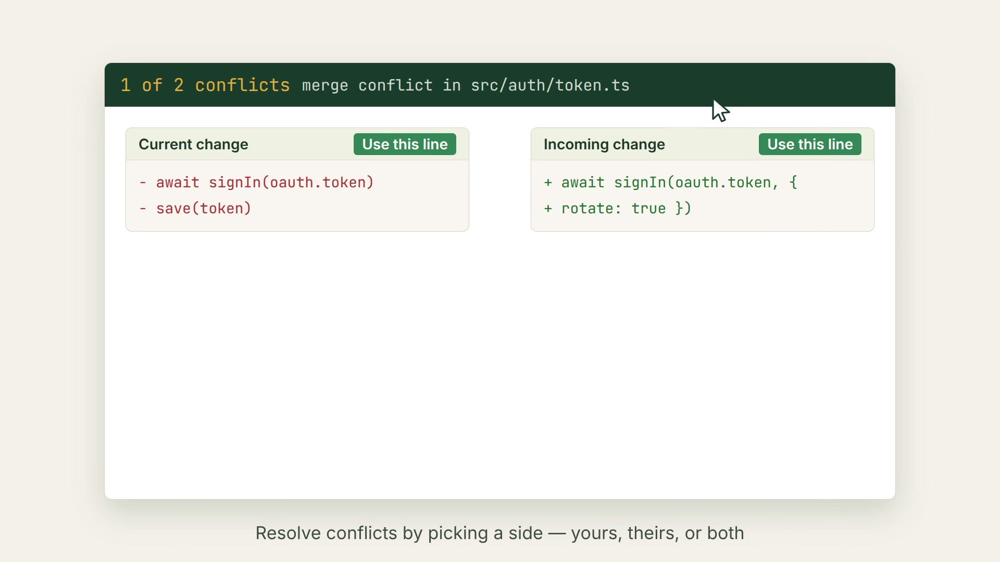
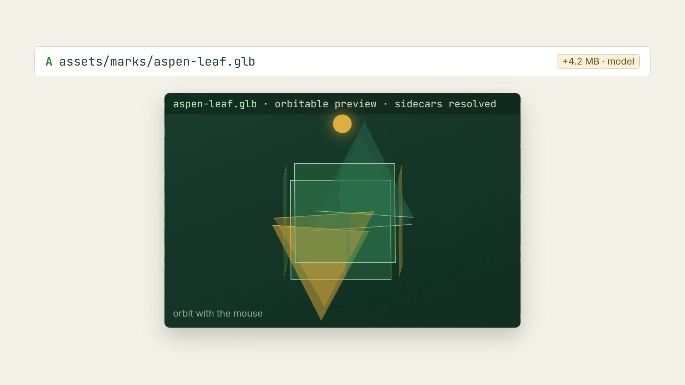

# Aspen — Aspen Git

**Aspen Git — Visual Git Client.** A visual desktop client for Git, built
with Electron + React + TypeScript, featuring an integrated
**AI commit-message agent** (any OpenAI-compatible API).

**Any AI agent writes your commit message, conflicts resolve with one click,
and 3D model changes render right in the diff view.**



### The app



### ✨ AI commit messages



### Merge conflicts



### 3D model previews



Built from a reverse-engineering study of GitHub Desktop 3.6.7's shipped
Electron artifact (typed IPC contract, porcelain-v2 status parsing, per-verb
git modules, and the AI commit-message flow: fixed system prompt →
randomized `<diff-TOKEN>` trust boundary → strict JSON `{title, description}`
parsing → cancellable request).

## Features

- **Repository manager** — add local repos, clone from URL or **from your
  GitHub/GitLab account** (sign in, browse and search your repositories, pick
  one and clone; folder name and destination suggested by main, and the
  destination folder is created for you inside the parent you pick), recent
  list, remove from the app. Clone is reached from the sub-menus that hold the
  other list verbs — the strip's **⋯** overflow menu, the repository picker's
  footer, **Manage repositories ▸ Clone…**, and **File ▸ Clone repository…** —
  plus the first-run screen.
- **Watch folder** — point the manager at the folder that holds your repos
  (e.g. `~/Documents/GitHub`) and the list follows it: new git folders are
  added, folders you moved or trashed drop out, and repos you added from
  anywhere else are left alone. Manual removals stick (the folder is
  remembered as dismissed until it leaves the disk); rescans run on startup,
  on folder changes, and on window focus.
- **Hosted accounts** — sign in with **GitHub** (the device one-time code, or
  a personal access token) and **GitLab** (OAuth PKCE for gitlab.com,
  token for self-hosted instances too); the Clone dialog grows a tab per
  account listing every repository you own, collaborate on, or see through an
  organization, with provider-side search (GitHub's Search API, GitLab's
  `?search=`), sorting and a public/private filter. Account rows show your
  real avatar and a profile link; every launch re-validates stored tokens —
  a revoked one signs that account out with a toast instead of failing later.
  Tokens are stored encrypted (Electron `safeStorage`) and never enter the
  renderer.
- **Create & publish** — **New repository…** (File menu, the first-run
  screen, or the manager) makes a new git folder on disk — optionally with
  a staged README — and can publish it in the same breath; any local repo
  without an origin publishes from **Repository ▸ Publish repository…** or
  the header's ⋯ menu. The dialog grows one tab per signed-in account —
  signed into GitHub twice? you pick which one, and which organization or
  group — then creates the hosted repo, adds `origin`, and pushes the
  current branch with upstream set. The first push is pinned to the
  publishing account's own token, so several accounts on one host can
  never push as the wrong one.
- **Branch picker** — filter, switch, create, rename and delete branches;
  remote-tracking branches listed separately and checked out as tracking
  branches; delete on the remote too.
- **Changes list** — porcelain-v2 status (new / modified / deleted / renamed /
  conflicted), per-file checkboxes that define the commit, staged/unstaged
  badges, one-click discard, discard-all, select-all, and a right-click menu
  (open file, show in Explorer, copy path/name, discard, plus a deep **Ignore
  ▸** submenu: the exact file, a name or `*.ext` anywhere, the containing or
  root folder, folder-direct `*`, `*.ext` limited to 1/2/3/any subfolder
  levels, or all untracked files at once — all appended to `.gitignore`).
- **Auto-refresh** — a debounced recursive watcher pushes working-tree changes
  to the UI (toggle in Preferences).
- **Merge-conflict handling** — a banner for an in-progress merge / rebase /
  cherry-pick / revert with conflict count and **Continue** / **Abort**;
  per-file *ours / theirs / done* resolution buttons.
- **Stash** — stash all changes (including untracked) under an optional
  message (subject + description, stored on the stash commit itself), and
  apply / pop / drop entries from the sidebar. ✨ **Summarize** describes an
  existing entry's stored diff with the AI agent and rewrites its message in
  place, replaying the original author, committer and date.
- **Diff viewer** — unified **or split** view, line wrap toggle, word-level
  highlighting of what actually changed inside a modified line, syntax
  highlighting (Prism), a large-diff guard, distinct binary / error / empty
  states, and synthesized add-diffs for untracked files.
- **Media previews** — selecting an image, video, or audio change shows it in
  the pane instead of the binary notice (Chromium playback, up to 128 MB);
  history previews read the exact committed blob, not the working tree.
- **3D model previews** — `.glb`, `.gltf`, `.fbx`, `.obj`, `.stl`, `.ply` and
  `.dae` changes open in an orbitable WebGL stage (three.js, imported lazily per
  format, so the library never enters the startup chunk): drag to orbit, scroll
  to zoom, plus Reset view, Wireframe and Grid toggles and a caption reporting
  triangles, meshes and animations. A model is rarely the whole asset, so the
  files it names are read alongside it — `.gltf` buffers and images, `.obj`
  material libraries and the textures they map, Collada and FBX texture paths —
  resolved from the same commit or working tree as the model (up to 48 files,
  32 MB each, with the caption saying when the set is incomplete). A model whose
  diff is readable text can be switched to it with one click, and back.
- **Commit** — summary + description (two `-m` paragraphs), restricted to the
  selected files via `git commit --only`; commit-message drafts are persisted
  per repository; **Undo** and **Edit latest commit…** (amend) with a
  tip-moved guard so you never undo somebody else's commit.
- **✨ AI commit messages** — generate title + description from the selected
  files' diff via any OpenAI-compatible endpoint (OpenAI, OpenRouter,
  Ollama, LM Studio…). Cancelable; confirms before replacing text you typed;
  API key stored encrypted via Electron `safeStorage`.
- **Integrated terminal** — a docked terminal panel (`Ctrl+```, the ⋯ menu
  or View ▸ Toggle Terminal) running a real interactive shell with the
  open repository as its working directory: ConPTY + PowerShell (Windows,
  preferring PowerShell 7), your `$SHELL` (macOS/Linux). xterm.js in the
  panel, node-pty in main; resize with the divider, restart or Clear from
  its bar, right-click or Ctrl+V to paste. Anything the shell changes in
  the working tree lands in the changes list through the same watcher the
  rest of the app uses; closing the panel ends the shell.
- **History** — searchable commit log (message + author filters) with paging,
  per-commit changed files and diffs, and commit actions: copy SHA, create
  branch from commit, uncommit (any commit drops out of history and its
  changes and message go back to the commit box; descendants are rewritten),
  cherry-pick, revert, open on GitHub.
- **Sync** — fetch / pull / push with ahead-behind badges and in-button
  spinners; first push sets upstream on `origin`. A push rejected because the
  remote moved ahead answers with a **Pull first / Pull and push again** toast
  instead of raw git output; a push rejected because you have no write access
  (the classic "cloned someone else's public repository") answers with
  **Create Fork** instead — see *Fork & pull request* below. Remotes
  authenticate through your system git credential helper
  (Git Credential Manager) — and when it
  declines, Aspen silently reruns the command once with the signed-in
  account's token for that host (never in the command line or `.git/config`).
  Add an `origin` from the header when a repo has none.
- **Fork & pull request** — the GitHub Desktop workflow, in-app. When Push is
  refused for lack of write access, a **Create Fork** button opens the fork
  dialog (also on the Repository menu as **Fork this repository…**): pick the
  GitHub account, and one verb forks the repository under it, rewires the
  remotes (your fork becomes `origin`, the parent is kept as `upstream`), and
  pushes your current branch — so Pull, Push, and the ahead/behind counts
  simply keep working, against the copy you own. A permission refusal from a
  GitLab remote (or any remote with no signed-in GitHub account on its host)
  stays a plain error instead of a dead button. **Create Pull Request** (the
  push-success toast or Repository ▸ Create Pull Request, `Ctrl+Shift+R`)
  opens the host's new-PR form for your branch: the parent is the base when
  you're on a fork — GitHub's cross-repository `user:repo:branch` head — and
  the origin otherwise; the base branch is that remote's real default branch;
  an unpushed branch or the default branch itself answer with the reason
  rather than an empty browser page.
- **Git identity** — warns and blocks the commit until `user.name` /
  `user.email` are set, with inline fields that write the repo-local config.
- **GitHub web links** — repo, branch, commit and compare URLs derived from
  the `origin` remote (hidden rather than guessed when it isn't mappable).
- **Menus & shortcuts** — Ctrl+Enter commit, Ctrl+Shift+X/Z stage/unstage all,
  Ctrl+Shift+S stash, Ctrl+Shift+M edit latest commit, Ctrl+Shift+F/P/U
  fetch/pull/push, Ctrl+Shift+R create pull request, Ctrl+Shift+G view on GitHub,
  Ctrl+R refresh,
  Ctrl+, preferences, plus a History menu for commit operations and an About
  dialog.
- **Newcomer-friendly defaults** — progressive disclosure instead of a mode
  switch: one context-aware **Sync** verb whose caret always lists Fetch, Pull
  and Push; Conflicts and Stash tabs appear when there are conflicts or
  stashes; staged badges appear once anything is staged; a one-time three-step
  coaching banner retires itself at your first commit (Preferences ▸ Behavior
  ▸ *Show tips for getting started*); and copy that says "not on the remote
  yet" instead of "no upstream". Every shortcut, menu and tooltip power users
  rely on is unchanged.
- **Self-update from GitHub Releases** — packaged runs check this
  repository's Releases a few seconds after launch and whenever you press
  **Help → Check for updates…**. On Windows NSIS installs the newer
  installer downloads in the background and a **Restart now** toast (or the
  About dialog) applies it; on every other build — and the portable exe —
  Aspen points you at the release page instead. Toggle the automatic pass
  in Preferences ▸ Behavior. See *Keeping Aspen up to date* below.
- Toasts with actions (e.g. **Undo** after a commit) and manual dismiss.
- Light / dark / system theme.

## Requirements

- Windows, macOS or Linux (macOS/Linux use the native menu bar and shell
  detection; `scripts/dev.sh` and `scripts/Aspen.sh` mirror the `.cmd`
  launchers)
- [Node.js](https://nodejs.org) 20+
- `git` on `PATH` (any recent version; Git Credential Manager recommended)
- An AI endpoint for ✨ Generate only (an OpenAI-compatible API key, or a
  local server such as `http://localhost:11434/v1` — Ollama). Everything
  else works without one.

## Run

```powershell
npm install
npm run dev        # develop with hot reload
npm test           # unit tests (Vitest)
npm run typecheck  # tsc for main+preload and renderer
npm run build      # production bundles into out/
npm run dist       # build an installer for the current platform
npm run dist:win   # Windows installer + portable executable
npm run dist:mac   # macOS DMG + ZIP
npm run dist:linux # Linux AppImage + DEB
```

Run the platform-specific distribution command on the target operating system.
`npm run dist:all` requests all three targets when the build environment supports
cross-platform packaging. (`npmRebuild: false` is deliberate: node-pty ships
N-API prebuilds that load unchanged in Electron, so the builder skips the
node-gyp step instead of demanding a full C++ toolchain.)

Then, on first run, open **Preferences** (File menu or the link on the empty
screen) and set the AI **Base URL**, **Model**, and **API key**, and press
*Test connection*.

## Running inside an agent / command sandbox (Windows)

Agent CLIs and CI runners often execute commands in a **sandboxed shell**:
on Windows the whole process tree (dev server, Electron, and the `git`
children Aspen spawns) then runs at *Low process integrity*, with write
access narrowed to a few folders and RPC/named-pipe service calls blocked.
Git can still read the repository — status, diffs and history look fine —
but the first command that writes into `.git` (stage, commit, stash…) dies
with `fatal: Unable to create '…\.git\index.lock': Permission denied`
even though the repository itself is healthy. (GitHub Desktop never hits
this; it is always launched normally at Medium integrity.)

Two mitigations ship with Aspen:

- **Actionable errors** — `src/main/git/sandbox.ts` recognizes the
  blocked `.git` write signature and replaces the raw `exit 128` fatal
  with an explanation that names both fixes below.
- **File-queue git broker** — `scripts/git-broker.mjs`. Register it once
  from a *normal* (non-sandboxed) shell:

  ```
  npm run git-broker:install     # = node scripts/git-broker.mjs --install-task
  npm run git-broker:status
  npm run git-broker:uninstall
  ```

  The Task Scheduler logon task keeps a tiny broker alive at normal
  integrity. It never talks to the app: the app drops a request JSON into
  `<queue>/requests` (inside the app's profile; override with the
  `GITDESK_BROKER_DIR` env var or `--queue <dir>`) and polls the matching
  response. The broker executes the queued git command with the same
  environment hygiene as the direct path and writes the result back. File
  I/O is deliberate — RPC/pipe based brokers are unreachable from inside
  the sandbox, while plain files cross the boundary reliably. `execGit`
  automatically reruns sandbox-blocked commands through the broker, so
  staging/committing keeps working in the UI and nobody notices.

Outside the sandbox nothing changes: commands run directly and the broker
is simply never consulted.

## How the AI agent works

1. You check the files you're committing and press **✨ Generate**.
2. Main process builds the diff of the selected files vs `HEAD`
   (untracked files are read and rendered as add-diffs).
3. The model receives a fixed system prompt (≤50-char title, optional
   description, JSON-only response, no lockfile chatter, no AI attribution)
   plus your optional custom rules, and the diff wrapped in a request-random
   `<diff-TOKEN>…</diff-TOKEN>` tag so diff content cannot forge the trust
   boundary.
4. The response is fence-tolerantly parsed into `{ title, description }` and
   validated strictly; a typed message triggers a replace confirmation first.
5. The request is cancellable (the button turns into **Cancel**).

## Signing in to GitHub/GitLab

Open **Clone a repository → Accounts** (or Preferences → Accounts).

- **GitHub — one-time code (device flow), and nothing else.** Aspen fetches
  a short code, you type it at github.com/login/device (or your GitHub
  Enterprise root's equivalent), Aspen polls until GitHub approves — the same
  dance `gh` and GitHub Desktop do. GitHub's authorization-code + PKCE
  browser redirect is deliberately not offered: GitHub sign-in is the
  one-time code or a personal access token. No local callback port is needed.
- **GitLab — browser sign-in (OAuth + PKCE).** The browser opens your
  instance's authorize page; Aspen catches the redirect on a loopback server
  at `http://127.0.0.1:8765/callback` (dispatch purely on the unguessable
  `state` parameter). PKCE means no client secret travels. Access tokens
  expire after GitLab's
  two hours — Aspen refreshes them silently.
- **Token sign-in — works for everything.** A GitHub classic PAT with the
  `repo` scope (or a fine-grained token with repository contents: read —
  enough to browse and clone; publishing needs the `repo` classic scope or
  a fine-grained token with contents: write), or a GitLab PAT with
  `read_api` + `read_user` (`api` to publish). Fill in the optional instance
  URL to sign a **GitHub Enterprise** or **self-hosted GitLab** server; that
  is the only way to use a server whose OAuth app you cannot register from
  the app. The token is validated against `/user` before anything is stored,
  then kept encrypted next to the settings file.

The code/browser sign-ins need an OAuth application you register once (or
bake into `src/main/providers/config.ts` and rebuild): GitHub — an OAuth App
with *Enable Device Flow* ticked and no callback URL at all, since the
one-time code never redirects back; GitLab — an
application, confidential **off**, redirect URI exactly
`http://127.0.0.1:8765/callback`, scope `api`. The ids are public, so they
ship empty — and both sign-in buttons are always clickable either way: with
an id on file GitHub shows the one-time code immediately and GitLab goes
straight to your browser for authorization, and without
one they first open a one-step setup **in the sign-in panel** (registration
page, the steps, one paste box — plus a copyable callback URL for GitLab) and
start the same sign-in the moment you paste and press **Save & sign in**. The
**Browser sign-in apps** fields in Preferences are the same two ids, for
replacing them later; the token path needs none of this and covers servers
whose application you cannot register.

Once signed in, the Clone dialog gets one tab per account listing your
repositories (owner, visibility, last push) with provider-side search,
sorting and paging (GitHub's Search API covers your own and your
organizations' repositories; typed text is also filtered client-side for
instant feedback). The create/publish dialog grows the same per-account
tabs plus an **owner** dropdown — your user, plus the organizations
(GitLab: groups) the token can create repositories in. Every launch
re-checks stored tokens against the provider: names and avatars refresh,
and a revoked token signs that account out with a toast. Clones, fetches,
pulls and pushes still prefer your system credential helper; your account
token is the automatic one-shot fallback that host rejects without — so a
token-only private-repo setup works end to end, and an existing Git
Credential Manager setup is untouched. (Publishing is stricter on purpose:
its first push authenticates with the publishing account's own token
before any helper, so with two accounts on one host the repository is
always created *and* pushed by the same one you picked.)

## Keeping Aspen up to date

Aspen updates itself from this repository's **GitHub Releases**
(`src/main/updates.ts`):

- **Windows (NSIS install).** The silent startup pass and the manual
  **Help → Check for updates…** both go through `electron-updater`, which
  reads `latest.yml` from the newest release, downloads the new Setup exe
  in the background (progress shows in the About dialog), and finishes with
  a **Restart now** toast. Restarting runs the installer and relaunches the
  updated app — your profile and settings are untouched.
- **macOS, Linux and the Windows portable exe.** The same check hits the
  Releases API (`releases/latest`) and compares `tag_name` semantically.
  A newer release offers an **Open releases** button; there is no
  in-place install (mac self-update additionally requires signed and
  notarized builds).
- Manual checks always answer with a verdict: newest release already
  running, a version is available, or why the check failed — including the
  friendly "no published releases yet" before the first release exists.
  The silent pass never nags on network errors, and
  **Preferences ▸ Behavior → Check GitHub releases for updates at startup**
  turns the automatic pass off. A signed-in GitHub account's token is used
  opportunistically for the API pass (higher rate limit; ready-made for a
  private repo).

### Releasing an update

1. Bump `version` in `package.json` (the number users see and the updater
   compares), commit, and tag it: `git tag vX.Y.Z && git push --tags`.
2. `npm run dist:win` — electron-builder writes the installer **and the
   updater metadata** into `release/`.
3. Create a GitHub Release for `vX.Y.Z` and upload, for each platform you
   ship, the installer **plus its `latest*.yml`** (and the `.blockmap` next
   to the Windows installer). The filename recorded in the yml must match
   the uploaded asset exactly, or the download 404s — when in doubt, upload
   exactly what `release/` holds.
4. Draft/prerelease versions are ignored by the stable updater channel, so
   beta tags don't reach normal installs.

## Project layout

```
src/shared/      models + typed IPC channel map (shared by all three sides)
src/main/        Electron main process
  git/           exec wrapper, porcelain-v2 parser, status/diff/staging/
                 commit/branches/log/sync/stash/ignore/workflow/github-url/
                 init (new-repo creation)
  watcher.ts     debounced recursive working-tree watcher (watch-filter.ts
                 holds the pure ignore logic)
  terminal.ts    integrated terminal: node-pty sessions, shell-choice
                 table, the two push channels (xterm.js renders them)
  ai/            commit-agent (system prompt, tags, parser, fetch call)
  providers/     GitHub & GitLab REST clients (pure mappers), device flow /
                 PKCE sign-in, token refresh, client-id config
  accounts.ts    signed-account store (encrypted per-account token sidecars)
  settings.ts    JSON settings + safeStorage-encrypted API key
  updates.ts     GitHub Releases self-update: electron-updater on packaged
                 win32 (latest.yml → background download → quitAndInstall),
                 Releases-API check + release-page handoff everywhere else
  windows.ts/menu.ts/ipc.ts  window, app menu, typed handle() registrar
src/preload/     contextBridge surface (window.aspen)
src/renderer/    React UI: Header, ChangesSidebar (+CommitBox, stash panel),
                 DiffView (unified/split, word-diff), HistoryView, Dialogs,
                 AccountsUi (sign-in panel, account rows, remote-repo pane),
                 ContextMenu, Toasts, TerminalPanel, AppStore (store.ts)
tests/           Vitest suites: porcelain / diff parsers, stash & log parsing,
                 github URLs, watcher filter, word-diff, provider mappers,
                 git auth-retry classifier, update version/release
                 parsing, plus an integration suite that
                 drives the real `git` binary in a temp repo
```

## Support

Aspen is free and open source. If it saves you time, consider supporting
Kurtis Hight and continued work on the project:

[](https://www.paypal.com/paypalme/kurtishight)

👉 **https://www.paypal.com/paypalme/kurtishight**

The same link is available in the app under **Help → Donate via PayPal**, or
in the **Help → About Aspen → Support the development** section.

## License

MIT
